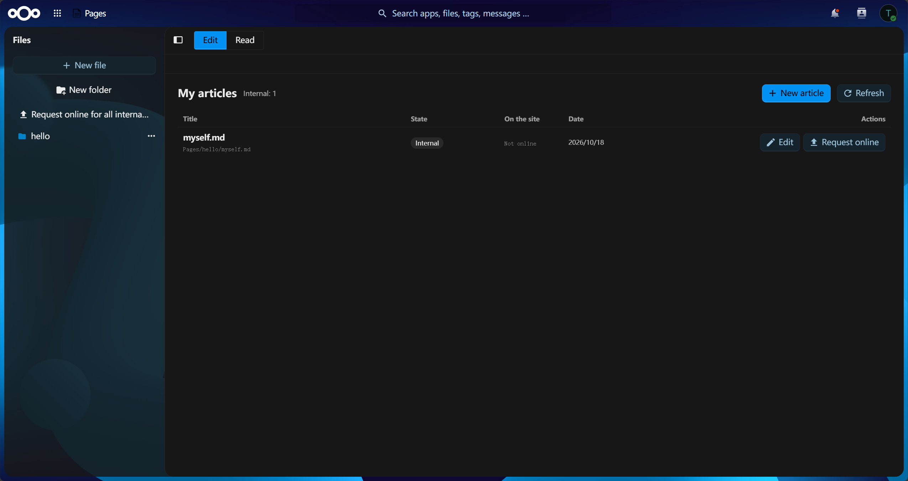

# Pages

**Edit a Jekyll site inside Nextcloud, decide page by page what the world may see, and publish it
with one click.** No terminal, no FTP, no second login: the files live in Nextcloud, so version
history, trash, sharing, desktop sync and group folders keep working, and the public site is still an
ordinary git repository (GitHub Pages, GitLab Pages, any remote).

<!-- The screenshots are captured by hand (see screenshots/README.md for what each one must show). -->



## What it does

- **Pages are edited in Nextcloud.** A page is a Markdown/HTML/CSS file in the author's own files, in a
  folder called `Pages/…`. It is a plain Jekyll page: no extra front matter, no lock-in, and the same
  file builds the same way whether it is on the site or not.
- **Jekyll builds it, the app shows it.** The build runs on the host and the preview is served by the
  app itself, so authors see the rendered site without leaving Nextcloud.
- **Review decides only whether a page goes live — never what it says.** Two facts decide it: what
  the site serves (`online/`) and whether a take-off request waits (`downRequest`). The state is
  derived:

  | state | meaning |
  |---|---|
  | **internal** | the site does not have it; visible and editable inside the app only (this is the default) |
  | **external** | `online/` holds it: the site serves the page, and the next publish carries it into the commit |
  | **requested** | a take-off request waits for a reviewer; the site keeps serving the page until the request is approved |

  A pending **online** request is a flag, not a state: the author's bytes wait frozen in `pending/`,
  the entry carries `candidate: true` (the request panel asks the API for `?awaiting=1`), and an
  approval moves `pending/` to `online/`. An edit alone never queues anything.

  ```
  internal ──request online (candidate)──▶ pending/ ──approve (publish)──▶ online/  (external)
     ▲                                        │
     │                                        └──reject / cancel (discard)──▶ internal
     │
  external ──request online (candidate)──▶ pending/ + online/ ──approve──▶ online/ gets the frozen bytes
     │                                        └──reject / cancel──▶ online/ kept (old page stays)
     │
     ├──request offline──▶ requested (downRequest) ──approve (take-down)──▶ internal
     │                          └──reject / cancel──▶ external (still served)
     │
     └──reviewer take-down (nothing pending)──▶ internal
  ```

  A `reject` answers the pending request and does not take a page down by itself: refusing an online
  request leaves the page as it was (internal, or external when an already-online page asked for new
  bytes), refusing an offline request leaves it external (the page was on the site and stays there).
  The one rejection that removes a page is an
  `external` entry with nothing pending — the reviewer's direct take-down, offered on each row of the
  **Manage** view. A take-down removes the served version, not the author's file: `online/` loses the
  page and the next publish carries the removal out of the commit, while the entry stays with its
  owner as long as the author still has the file (that is where the next request lands) and is
  forgotten only when the file is gone too. When the site's own `source/` holds the same path, the
  take-down removes the overlay only and the skeleton file surfaces again, so the commit tree stays
  the `source/` + `online/` assembly.

  Deleting an author's file is not a take-down: `online/` keeps the published copy and the entry is
  filed as a take-off request (`sourceDeleted: true`) for a reviewer to decide. **Renaming** a
  published file does the same for its old address — the site still serves it there, so the old
  target gets that take-off request — while the new name starts as an ordinary draft and reaches the
  site only through a reviewer's approval. A folder rename or delete files the request for every
  published target under the old prefix.

  A pending request never changes what the site serves: `external` is `online/` holding the page, and
  the commit tree is the flat `source/` + `online/` merge — the only window is between a decision and
  the next publish. The manifest carries no published list: it records only `owner`,
  `candidateDigest`, `downRequest`, `decidedBy` and `note`, while `online/` and `pending/` are the
  record. Editing a page does not take it off the site: readers keep the committed revision until a
  new one ships.
- **Three derived trees on the host: commit, preview and review.** The **commit tree** is the flat
  `source/` + `online/` merge (online wins on a duplicate path), is **always a local git repository**,
  and is **never built**: a publish verifies it, then stages, commits and pushes. The **preview tree**
  adds every author's folder, so an internal page is previewable; it is the one built for the ordinary
  preview and is never a git repository. The **review tree** adds `pending/` over the same two layers
  and builds its own output, served by `?tree=onlinepreview`, so a reviewer sees the frozen candidate
  exactly as it would ship. All three are derived: Apply source rebuilds them from the Nextcloud
  folders, and only the git history inside the commit tree is not regenerable.
- **Author content reaches the trees as events.** A save is one file delta to the bridge, and a
  reviewer's decision is its own delta: an approval moves the frozen `pending/` candidate to
  `online/` (and into the commit and review trees), a take-down removes it again — or puts the
  skeleton's own file back when `source/` has the same path, because the online layer only hid it.
  The one-shot boot overwrite repairs the preview tree's author area from the author folders, so an
  event the bridge missed is healed without re-saving anything.
- **Publish = commit, always.** A site without a git remote is a supported configuration: the publish
  commits locally and stops there. Push happens only when a remote is configured, and a push that the
  remote rejects (it has new commits) is answered with a structured error naming the count —
  `推送失败：远端有 N 个新提交` — and never with a "not pushed" state, because that state does not
  exist. A commit that was made is published, so entries it carried show as **已上线** whatever the
  push did; a failed push gets no label of its own — the badge stays **已上线**, the per-row push mark
  is **未推送 · 重试**, and `occ pages:doctor` names the last publish push that failed. Before it
  commits, a publish verifies that the commit tree equals the flat merge of `source/` + `online/`
  (online wins on a duplicate path, a top-level `.git` is skipped); a mismatch writes nothing and is
  refused with `409 WORK_DRIFT`, and the answer says to run Apply source first.
- **One site per instance.** No site id appears in a route, in the bridge's state file, in the working
  copy or in a preview token. Multi-site is not a setting; run one Nextcloud per site (or use groups
  and one site, which is the normal case).

```
Nextcloud (source of truth)              host (pages-bridge)                         remote
  source/ + online/  ──────────────────▶  commit tree   (flat merge; never built) ──commit──▶ git push
  source/ + online/ + author folders ──▶  preview tree  (built; ordinary preview)
  source/ + online/ + pending/ ────────▶  review tree   (built; ?tree=onlinepreview)
        ▲
        └── Import / Pull: a confirmed, complete replacement (archive / remote HEAD)

The three trees never feed each other; each is assembled from the Nextcloud layers:
  * commit:  source/ + online/                  → the git commit (a publish only verifies it)
  * preview: commit + every author's folder     → the page authors see, internal ones included
  * review:  commit + pending/                  → the frozen candidate, as it would ship
```

The Nextcloud folder is the **sole source of truth** for the site source, and its writers are the Files
app / WebDAV, the tarball **Import** and the git **Pull**. Anything entering from outside does so only
as a confirmed, complete replacement: there is no merge, no rebase and no dirty gate anywhere. The app
itself no longer edits the site's source — it has one page with four views (编辑 / 上线请求 / 管理 / 阅读),
and every file endpoint it serves addresses an **author area** (`<author_root>/<uid>/…`).

Nextcloud PHP cannot execute host binaries and must not be given the power to start host processes, so
the work that needs a real shell lives in a separate service: **`pages-bridge`**, a zero-dependency
Python daemon on the Nextcloud host. The app is the control plane, the bridge is the data plane, and
the two talk over loopback with two generated secrets. Nothing is installed or started behind your
back: enabling the app never touches files outside its own data directory.

## Requirements

- **Nextcloud 34+** — this release is built and tested against 34 (`appinfo/info.xml` still declares
  `30`–`34`, so older instances install it too; nothing in the app needs 34 specifically).
- **PHP 8.2+**, no extra PHP extensions (the declared floor in `info.xml` is 8.1; 8.2 is what CI lints
  and what this release was tested on).
- A **host** that can read the Nextcloud data directory and reach the git remote, with:
  - **Python 3.11+** (standard library only — no pip, no Docker, no virtualenv; `tomllib` is the
    reason for 3.11),
  - **git**,
  - the site's own toolchain — for Jekyll: **Ruby with `bundler` and the `jekyll` gem**. Pages bundles
    no generator: it runs the build the site itself declares.
- The bridge runs as a systemd service on the same machine as Nextcloud. Hosted pairing (the easy
  path) is same-machine only; a bridge on another host is configured by hand in its TOML.

## Install

Five steps, about ten minutes. `occ` means the Nextcloud console (`sudo -u www-data php occ …`, or
`occ` in a snap install).

1. **Install the app.** Unpack the release tarball into `apps/pages` (or install it from the App Store),
   then:

   ```bash
   occ app:enable pages
   ```

2. **Install the bridge on the host.** From the `bridge/` directory of the release:

   ```bash
   sudo ./install.sh
   ```

   It checks Python, copies the daemon to `/opt/pages-bridge`, creates `/var/lib/pages/{state,overrides,logs}`,
   installs `pages-bridge.service` (the unit file is `bridge/pages-bridge.service`), starts it, and
   prints a **one-time pairing code** (valid 600 s, dead after 3 wrong attempts) together with the
   bridge URL. It copies `bridge/pages-bridge.toml.example` to
   `/etc/pages-bridge/pages-bridge.toml` **without generating any secret** and never overwrites an
   existing file.

3. **Point the app at the bridge and pair.** *Administration settings → Pages*: enter the URL
   (`http://127.0.0.1:8787`) and the pairing code, press **Pair**. The app generates both secrets,
   discovers the data directory from Nextcloud's own configuration and hands everything to the bridge
   in one request — nothing has to be copied out of a config file by hand. Only fingerprints are ever
   shown afterwards.

4. **Choose the site.** Still on the settings page: the **site storage user** (the Nextcloud account
   under the data directory that owns the site), the **Nextcloud folder** (`/Sites/my-site`), the
   **git remote** and the **branch**. They are written through: leaving any of the four saves the whole
   block and pushes it to the bridge in one call, and a value the bridge refuses leaves every field at
   its previous value.

   Then there is **one button, whose label follows the remote field**: with no remote it reads
   **Create** and only makes the local repository (`git init`, nothing is written to Nextcloud: content
   comes from Files or Import); with a remote it reads **Pull** and runs the whole pull chain (fetch,
   land the remote branch, archive it, replace the Nextcloud folder, rebuild the preview). A folder
   that is still empty is filled without a dialog; a folder with content asks for confirmation first
   and backs it up.

   Once the repository exists the **remote and the branch are locked** for good - changing them would
   silently repoint an existing history. They render read-only with their own hint, and the API refuses
   a change with a 400. The reset in the danger zone (which deletes the trees) is the only unlock.
   When content is registered (the visibility manifest is not empty, or author files were pushed), the
   **site storage user** and the **site folder** become read-only too: moving either would leave the
   manifest and the mirror describing paths that no longer exist. The **author content directory** is
   not one of them - it stays editable: a move is carried out on both sides, the published and
   waiting files are rewritten under the new name, the manifest is re-keyed and the bridge rebuilds
   its trees.

5. **Check the installation.**

   ```bash
   occ pages:doctor
   ```

   Every row must be `OK`; a failing row prints its own hint. `occ pages:doctor --json` carries the
   same report machine-readably, including the effective bridge parameters and where each value came
   from (`app`, `toml`, `default`).

To verify from a browser: open **Pages** in the app menu, create an article under `Pages/…`, request
it online, approve it as a reviewer and press **Publish**. `git log` in the remote repository shows the
commit; the site serves the page.

## Import and Pull: how content gets into the folder

The site folder is written by exactly three things, and the app is none of them:

1. **The Files app / WebDAV** — the everyday way (edit a file directly, drop a folder in).
2. **Import** (`POST /api/site/source/import`, administrator only, multipart zip/tgz) — the archive is
   validated first (a `_config.yml` at the top level or inside a single top-level folder, which is
   stripped; no zip-slip; a size limit; `_site/`, `.git/`, `vendor/` and `__pycache__/` dropped), then
   the folder is **backed up into appdata**, cleared and written through the Nextcloud file API. The
   answer names the file count, the skipped entries and where the backup went.
3. **Pull** (`POST /api/site/pull`, administrator only, only with a remote) — the commit tree is
   fetched and the remote branch is landed (unborn `HEAD` → checkout, otherwise a hard reset: the
   remote replaces the local content, it is never merged), the resulting `HEAD` is packaged as a
   tar.gz, and the app replaces the folder with it. With content in the folder the confirmation states
   the ahead count and how many local unpublished files will be backed up first; an empty folder is
   filled without a dialog, and the backup is taken before anything is overwritten.

Both end in the same helper: one confirmed, complete replacement, then all three derived trees are
rebuilt and the preview is built. Neither ever merges.

## Permissions

Two capabilities, granted per group on the settings page; they are independent, and administrators
always hold both.

| capability | who | what it allows |
|---|---|---|
| **authoring** (`author_groups`, empty = every signed-in user) | anybody who writes | create, edit, move and delete pages inside **their own** `Pages/…` folder, and request a visibility change for them |
| **review and publishing** (`review_groups`) | reviewers | the review queue (approve, reject with a note), the **Manage** view (take any online page off the site, whoever wrote it) and the publish itself (commit, and push when a remote is configured) |

- **Publishing is part of the review grant** (the retired `publish_groups` was merged into it).
  There used to be a third grant; granting it without review made no sense, so publishing merged into
  review. The retired `publish_groups` and `edit_groups` keys grant nothing: they are kept for
  compatibility reads only, and only `review_groups` is read.
- **The review grant decides, and the decision is recorded.** A reviewer may decide about any page,
  including one they own: on an instance whose only reviewer is also the author, refusing
  self-decisions would make every request undecidable. What matters is that the record names who
  decided (`decidedBy`), which is also what an author sees when a request comes back with a note.
  Anyone with the review grant may also file a request for somebody else's page — that is the
  reviewer's own route to the same decision.
- **Authors never see the site skeleton.** Endpoints take *page targets* inside the author's area and
  answer `403` for somebody else's page, `400` for a path the app does not address. Every file arrives
  in the site as `<author_root>/<uid>/…` (default `tmp`, the *author content directory* setting), so
  Jekyll builds it like any other page.
- **Reading is open** to every signed-in user (the article list, tags, single articles, votes and
  comments); the site's own source tree needs the review grant. Votes and comments live in the
  Nextcloud database only and are never published to the static site.
- Preview pages are served through the app with short-lived tokens; the resolved address is what
  decides, and anything outside the preview build output is refused, so a symlink cannot leak the
  source.
- The review preview replaces only the page itself: `?tree=onlinepreview` selects a tree for the one
  request that names it, so the stylesheets, images and followed links the page pulls in are still
  served from the ordinary preview build.
- The two secrets are generated by pairing and replaced by **Rotate secrets**. The push that carries
  new secrets is authenticated with the old one; a rejected rotation leaves the old pair in place.

The visibility record lives in **one file in the app's private appdata**
(`appdata_<instanceid>/pages/review.json`) — not in anybody's file tree, not visible in Files, not
served over HTTP, so nobody whose work it records can edit it. It is written through a single
locked read-modify-write guarded by the file's ETag, so two reviewers clicking at once cannot lose
each other's decisions. Inspect or back it up with `occ pages:manifest` (`--json` for the raw
document). The database table (`pages_articles`) is a query cache; anything that
*decides* something asks the manifest.

## Configuration

The settings page is **four blocks and a danger zone**, and it has no save button: every field saves
as soon as it is committed in the UI.

| block | control | what it sets |
|---|---|---|
| ① Connection | URL | where the app reaches `pages-bridge`; saved automatically after a pause in typing (app-side only) |
| ① Connection | Pairing code (+ **Pair**) | one-time pairing; generates both secrets (shown while unpaired) |
| ① Connection | **Rotate secrets** / **Pair again** | replace both secrets through a confirmation dialog / pair with a new one-time code |
| ② Site | Site storage user | the Nextcloud account under the data directory that owns the site; leaving it empty stores the current administrator's uid (read-only once content exists) |
| ② Site | Nextcloud folder (source of truth) | the site folder inside that user's files (read-only once content exists) |
| ② Site | Git remote (optional) | the repository a publish pushes to; empty = publish without a remote |
| ② Site | Branch | the branch that gets published |
| ② Site | **Apply source** | mirror both trees and rebuild the preview; no commit, no push, no config change |
| ② Site | **Import source…** | a zip/tar.gz that **replaces** the folder (confirm → backup → clear → extract) |
| ② Site | **Create / Pull** (one button) | with no remote: create the local repository (`git init`; Nextcloud untouched); with a remote: the whole pull chain, with a confirmation only when the folder has content. Locked (and hidden) rules below |
| ③ Authors | Author content directory | the site-relative directory authors are mirrored into (`author_root`, default `tmp`; movable at any time - the published and waiting files move with it, the manifest is re-keyed and the bridge rebuilds its trees) |
| ③ Authors | Orphan owner directory | the site directory that receives a published article when its author deletes it (`orphan_owner`, default `Admin`); one folder name only, and it must not be a real user name - real uids are excluded from the site mirror |
| ④ Permissions | Authoring grant | the groups that may write pages (empty = every signed-in user); saved on change |
| ④ Permissions | Review and publishing grant | the groups that may review, edit the site's own files and publish; saved on change |
| Danger zone | **Reset Pages (back to a fresh install)** | clears the app's bookkeeping and the bridge's copies, after a backup on both sides; password-confirmed; user files are never touched |

The four site fields, the author content directory and the orphan owner directory are **written
through**: leaving a field saves it immediately (validate and store, then push to the bridge what the
bridge owns), and a bridge that refuses or does not answer puts every field back to the last accepted
value. The orphan owner directory is app-side only: it names a directory in the site source, so saving
it pushes nothing. The two fields that name content (storage user, folder) are disabled and rejected by
the API once content exists; only the danger zone unlocks them. The author content directory is exempt:
a move is accepted at any time, the pages the site serves (and any candidate waiting for review) are
rewritten under the new name, the manifest is re-keyed, and the bridge rebuilds its trees. The move is
all or nothing: when a file cannot be moved the files this call moved are put back, the stored value
stays where it was, and the answer is a `409` naming what could not move — retrying finishes it.

**Everything else is set outside the page**, because it has a better owner:

```bash
occ pages:config list                     # every settable key, its value and where it comes from
occ pages:config get build_timeout_s
occ pages:config set build_timeout_s 240  # then: occ pages:push
occ pages:config set mirror_verify sha256
occ pages:config set exclude ''           # an empty value removes the override
```

The **16 global bridge parameters** are the bridge's own tuning. They are documented in
[`bridge/pages-bridge.toml.example`](bridge/pages-bridge.toml.example); `occ pages:config` is the
scriptable way to override one from Nextcloud, and `occ pages:push` hands the overrides to the bridge:

| key | type | default | meaning |
|---|---|---|---|
| `listen` | string | `127.0.0.1:8787` | address the bridge HTTP API binds to |
| `nc_data_root` | string | `/var/snap/nextcloud/common/nextcloud/data` | Nextcloud data directory |
| `work_root` | string | `/tmp/pages` | root of the site's directories; the commit tree itself unless `work_path` is set |
| `state_dir` | string | `/var/lib/pages/state` | bridge state (`state.json`, the pushed `effective.json`, the pairing code) |
| `override_dir` | string | `/var/lib/pages/overrides` | generated Jekyll config overrides |
| `log_dir` | string | `/var/lib/pages/logs` | build log |
| `build_timeout_s` | int | `180` | build timeout; on expiry the whole process group is killed |
| `build_debounce_ms` | int | `700` | how long to wait after a change before building |
| `log_tail_lines` | int | `200` | log tail kept and shown |
| `mirror_verify` | string | `size+mtime` | change detection: `size+mtime` or `sha256` |
| `mirror_delete_guard_ratio` | float | `0.2` | abort a mirror that would delete more than this share |
| `mirror_delete_guard_min` | int | `20` | …but always allow deleting up to this many entries |
| `mirror_preserve_exec` | bool | `false` | keep the source executable bit when copying |
| `mirror_use_gitignore` | bool | `true` | let the repository's `.gitignore` define what is not source |
| `exclude` | list | `[".vscode", ".idea", ".DS_Store"]` | names added to the exclusion set |
| `unexclude` | list | `[]` | names removed from the exclusion set (`.git` cannot be removed) |

An unknown key is refused with the list of settable keys; a value the key's type cannot take is refused
rather than stored. Every effective value comes from one of three places, in this order: **from app**
(stored in Nextcloud, pushed to the host in `state_dir/effective.json`, mode `0600` — it also holds
the secrets, so mind your backups), **from TOML** (`/etc/pages-bridge/pages-bridge.toml`, never
rewritten by the app), or the **built-in default**.

Two things are deliberately not on the settings page and are not duplicates of it: the **build recipe**
(`output_dir`, `command`, `install_cmd`, `env`, `overrides` under `[site.recipe]`) and the **site-level
exclude list** belong to the bridge's TOML. `PUT /api/site` still accepts both for scripts; the stored
values are kept, and a save that omits them does not reset them.

`listen` is the one key with a threefold guard, because it is also the way to make the bridge
unreachable: it only takes effect at the **next start**, a pushed address that cannot be bound falls
back to the TOML address at startup, and while the bridge is unpaired the only allowed address is
loopback. A wrong push can always be corrected from the settings page that fixes it.

## Troubleshooting

Start with `occ pages:doctor`. Every row is a check with a detail; a failing row prints a hint. The
rows that fail in practice:

| `doctor` row | when it is red | what to do |
|---|---|---|
| `bridge URL` | no URL is stored | set it on the settings page |
| `bridge reachable` | the app cannot reach the bridge | `systemctl status pages-bridge`, `journalctl -u pages-bridge`, `curl -fsS --noproxy '*' http://127.0.0.1:8787/health` |
| `shared secret` | no secret is stored | pair the bridge |
| `site configured` / `site storage user` / `source folder` | the site is incomplete | fill in the site fields (leaving a field saves and pushes it) |
| `site readable (Files API)` | Nextcloud cannot read that folder | check the path, the user and the permissions |
| `config synced to the bridge` | the bridge has an older configuration | `occ pages:push` |
| `bridge parameters` | a stored override is no longer pushed | `occ pages:push` |
| `deployment` | — (a row of facts, never a failure) | `HEAD <hash> · remote ahead N commits · M unpublished local files` |
| `last push failure` | the last push failed (a warning, not a failure) | the detail names the time, the author and the code — see the exit codes below |
| `author content directory` / `site author source` | the site's Jekyll config and the app disagree about where author pages live | set `authors.source` in the site's `_config.yml` to the author content directory (or change the directory) |
| `author areas` / `author folder names` / `authors` | an author's folder is missing, misnamed or unreadable | create/fix the folder; it is created on first use |
| `visibility states` | the visibility manifest is missing | not an error: it is written by the first request, decision or publish |
| `routes resolvable` / `app navigation entry` | the app did not register | re-enable the app, check `occ app:list` |
| `no removed legacy APIs` / `app privilege boundary` | the code touched something the design forbids | report it |

**`occ pages:push` exit codes** are a retry taxonomy, not a boolean:

| code | meaning | what to do |
|---|---|---|
| `0` | pushed | nothing |
| `1` | the bridge answered and refused this configuration | repeating cannot help — fix the reported cause first |
| `2` | the bridge did not answer at all | nothing was decided; run it again once the service is back |

`occ pages:repair` re-derives what is derived instead of asking you to re-save every page: it re-scans
the author folders into the article table, re-pushes the site configuration, re-runs the one-shot
author overwrite (which repairs the preview tree's author area from the author folders) and
forces one rebuild of the preview tree (same exit codes as `pages:push`).

**A save whose push fails** leaves the entry marked **“not pushed · retry”**, in the file tree and in
*My articles*: the file is saved, the bridge just does not have it yet. Clicking the mark repeats the
same push and clears it. The mark is browser state; `pages:doctor` keeps the durable record (time,
author, code, whether a retry can help).

**Files-app edits do not rebuild the preview.** The Files app writes the source folder without telling
the bridge, so the preview stays at the old build: open *Administration settings → Pages* and press
**Apply source** (`POST /api/site/build`; an administrator). It rebuilds the three derived trees and
the preview, and it never commits or pushes.

**Reset Pages (danger zone).** The button at the bottom of the settings page returns the app to a
fresh install: the visibility manifest, the article cache, the site settings, the grants and the
pairing are cleared, and the bridge deletes its three derived trees (they are derived data: the
mirror rebuilds them from the Nextcloud folder and the build regenerates the preview). **Your files are
never touched** - the site folder and every author's `Pages/` folder stay as they are - and the app
side is backed up first (`appdata/pages/reset-backups/…`); the bridge side is simply deleted and can be
regenerated. It needs the administrator's Nextcloud password. A reset whose bridge half could not run
leaves `bridge cleanup pending` in `occ pages:doctor`; running the reset again retries only that half
(both halves are idempotent).

**Bridge logs** are one JSON object per line:

```bash
journalctl -u pages-bridge -n 100 --no-pager
sudo systemctl restart pages-bridge          # after code or config changes
```

| symptom | cause and fix |
|---|---|
| `/health` answers `"paired": false` | nothing is configured yet: issue a code (`python3 -m pages_bridge -c /etc/pages-bridge/pages-bridge.toml pair-code`) and pair again; a code dies after 600 s or 3 wrong attempts |
| pairing answers `409 ALREADY_PAIRED` | the bridge already holds secrets. To pair it again: remove `<state_dir>/effective.json`, restart the service, issue a new code |
| the settings page cannot reach a bridge that is up | `http_proxy` hijacking loopback: use `curl --noproxy '*'` and add `127.0.0.1,localhost` to `no_proxy` |
| the bridge refuses to start with `an unpaired bridge may only listen on loopback` | pair first, or set both secrets in the TOML to run the hand-written path |
| `git push` fails with `Permission denied (publickey)` | ssh only tries the default key names: point `IdentityFile` at your key in `~/.ssh/config`, use that Host alias in the git remote, and give the deploy key write access |
| a mirror answers `409` `MIRROR_DELETE_GUARD` | the round would delete more files than the guard allows: repeat with `{"dry_run": true}` to see the plan, then `{"force": true}` if it is correct |
| an author's posts are reported `missing` | the source file is not (yet) in that folder. Nothing is deleted by design; a vanished folder withholds deletions entirely |
| a build reports `timed_out: true` | raise `build_timeout_s` |
| `/env` reports the source as not readable | the service user cannot read the data directory: change `User=`/`Group=` in `pages-bridge.service` |

Deeper bridge material — every route, the two trees, the author payload, the TOML — is in
[`bridge/README.md`](bridge/README.md).

## Uninstall

1. **The bridge**, on the host:

   ```bash
   sudo ./install.sh --uninstall     # stop, disable and remove /opt/pages-bridge and the unit
   ```

   `/etc/pages-bridge/` and `/var/lib/pages/` are kept (they hold the configuration and the pushed
   secrets); remove them by hand to clean up fully.

2. **The app**:

   ```bash
   occ app:disable pages
   rm -rf apps/pages                 # or: occ app:remove pages
   ```

3. **What stays behind**, deliberately: the site source and the pages in Nextcloud (ordinary files —
   they are not deleted), the git repository the site was published to, the app's `appdata_<instanceid>/pages/`
   folder (the visibility manifest) and the `pages_articles` table. Delete them
   only if you want a clean slate; nothing of it is read after the app is gone.

## Development

The app is PHP (Nextcloud app framework) plus a Vue 3 + CodeMirror 6 front end built by Vite, and a
Python bridge. No composer dependencies, no framework of its own.

```bash
npm ci                            # install the front-end dependencies
npm run build                     # writes js/ and css/ — committed, and CI verifies they match src/
node tests/code/proof-frontend.mjs     # template proof: no template reads a method, every component renders
python3 bridge/tests/test_smoke.py  # the bridge alone: mirror, delete guard, git, HTTP, preview policy
```

| path | contents |
|---|---|
| `lib/` | the app: controllers, permission checks, bridge client, review store |
| `src/` | front-end sources (Vue 3 + CodeMirror 6); `npm run build` writes `js/` and `css/` |
| `bridge/` | host-side daemon (`pages_bridge`), systemd unit, installer, its own README |
| `templates/` | the settings page and the app shell |
| `l10n/` | translations (`zh_CN` today; the source strings are English) |
| `tests/code/` | the front-end proof, the four smoke proofs and the store probe — no instance needed |
| `tests/live/` | the live acceptance suites (need a deployed instance and its credentials) |
| `tools/package.sh` | builds the App Store tarball (`build/pages-<version>.tar.gz`) |
| `tools/` | packaging, release check and lockfile check |

Notes for contributors:

- **The build output is committed.** The App Store package ships `js/` and `css/`, and users never run
  node. After changing anything in `src/`, run `npm run build` and commit the result in the same
  change; CI fails if `git diff --exit-code js css` is not empty.
- `php -l` over `lib/`, `appinfo/` and `templates/`, the front-end proof, the bridge smoke tests and an
  l10n audit run on every push (`.github/workflows/ci.yml`). The audit fails on any `t()` key that is
  missing from `l10n/zh_CN.json` (and on a key in the workflow's `KNOWN_GAPS` once it becomes
  translated, so that list can only shrink; it is empty now). `tools/package.sh` then checks the
  archive: no `src/`, `tests/` or `tools/` inside it, and `js/pages-main.js` present.
- **The live acceptance suites under `tests/live/*.sh` need a real instance and their own credentials**;
  they are not part of CI and must be run by hand against a throwaway install:

  ```bash
  sudo ./tests/live/test-auth.sh grant     # issues a one-shot app password → /root/.pages-test-pw (0600)
  sudo NC_USER=alice ./tests/live/test-permissions.sh
  sudo ./tests/live/verify-deploy.sh
  ```

  They create throwaway users and groups, drive the real API with basic auth, and restore the
  configuration afterwards. `tools/release-check.sh` runs the build, the lockfile check, the bridge
  tests and the front-end code checks the local node can run, then packages.
- `tests/code/store-probe.php` exercises the review manifest's own logic against in-memory fakes (ETag
  locking and retries, the JSON shape, corrupt files, cache mirroring); it needs a Nextcloud checkout:
  `snap run --shell nextcloud.occ -c "php tests/code/store-probe.php"`.

## License

AGPL-3.0-or-later. See [LICENSE](LICENSE).
